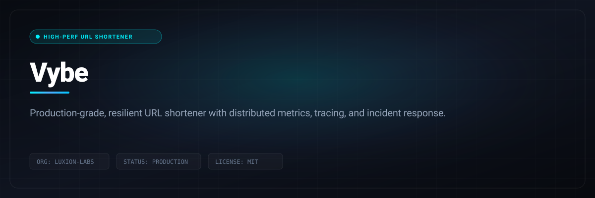

# Vybe

> Production-grade, resilient URL shortener with distributed metrics, tracing, and incident response.

```bash
git clone https://github.com/Luxion-Labs/Vybe.git && cd Vybe && docker compose up --build
```



[](https://vybe.luxionlabs.com) [](LICENSE) [](CONTRIBUTING.md)

## Overview
Production-grade, resilient URL shortener with distributed metrics, tracing, and incident response. Built by Luxion Labs as part of our high-velocity open-source engineering ecosystem.

## Features
- Sub-millisecond URL redirection backed by distributed Redis caching.
- Prometheus metrics exporter with preconfigured Grafana dashboards.
- Resilient rate limiting and automated incident response runbooks.
- 100% Dockerized development and production deployment manifests.

## Architecture and Stack
Python, Flask, PostgreSQL, Redis, Prometheus, Grafana, and Docker Compose.

## Quickstart
```bash
git clone https://github.com/Luxion-Labs/Vybe.git && cd Vybe && docker compose up --build
```

## Maintainer Response SLA
Luxion Labs enforces a strict 24-hour response SLA on all community issues, feature proposals, and pull requests. See [CONTRIBUTING.md](CONTRIBUTING.md) for full development guidelines.

## License
Distributed under the MIT License. See [LICENSE](LICENSE) for more details.
